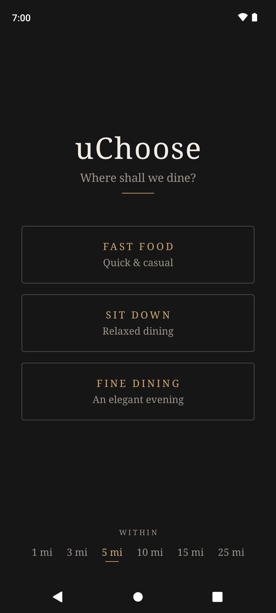
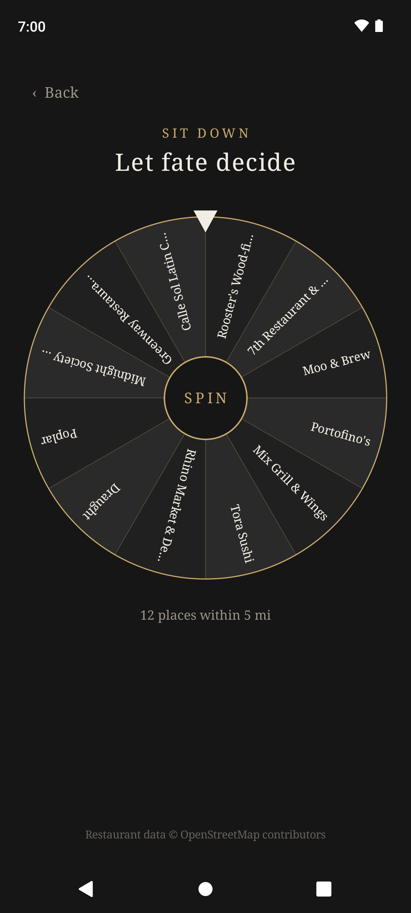
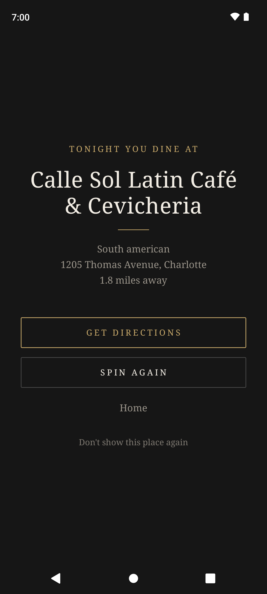
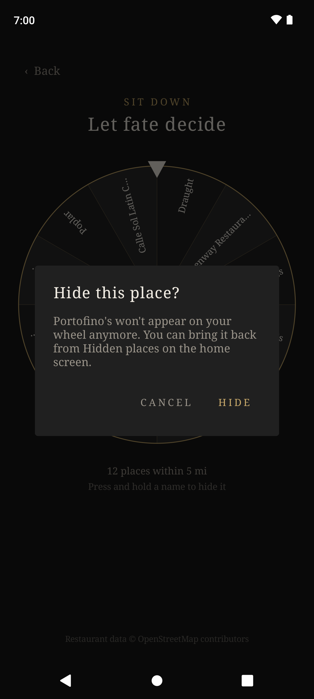

# uChoose

**Can't decide where to eat? Let the wheel decide.**

A simple, classy Android app that finds restaurants near you, 
puts them on a wheel, and picks one for you with a single spin.

[**⬇ Download the latest version**](../../releases/latest)

 

<table>
  <tr>
    <td align="center"> <b>1. Pick a style</b></td>
    <td align="center"> <b>2. Spin the wheel</b></td>
    <td align="center"> <b>3. Go eat</b></td>
  </tr>
</table>

---

## Welcome 👋

We've all been there: "Where do you want to eat?" "I don't know, where do *you* want to eat?"

uChoose ends that conversation. Tell it what you're in the mood for and how far you're willing to go, and it does the rest. There are no accounts, ads or sign-ups. Open it and spin.

---

## What it does

### 🍽 Choose your kind of meal
The home screen gives you four choices:

| | What you'll get |
|---|---|
| **Fast Food** | Burgers, tacos, sandwiches: anything quick and casual. |
| **Sit Down** | Regular restaurants where you're seated and served. |
| **Fine Dining** | Steakhouses, bistros, seafood and other upscale spots. |
| **Coffee & Cafés** | Coffee shops and cafés for a quiet cup or a quick pick-me-up. |

> **Note:** Restaurant listings don't include prices, so uChoose sorts places by type and by clues in the name and cuisine. "Fine Dining" looks for words like *steakhouse*, *chophouse*, *bistro* or *grille*, and for cuisines like French and seafood. Big chains like Olive Garden or Applebee's always go under Sit Down. Some places may land in an unexpected category now and then.

### 📍 Set your distance
Across the bottom of the home screen, choose how far you're willing to travel: **1, 3, 5, 10, 15 or 25 miles**.

> **Note:** Only restaurants inside that distance are shown, measured in a straight line from where you are. Your choice is remembered next time. If nothing fits, the app says so, and you can pick a bigger distance.

### 🎡 Spin the wheel
uChoose fills a wheel with up to **12 restaurants** near you. Tap **SPIN** in the center and let fate decide.

> **Note:** A different random mix of nearby places is picked each time, so the wheel changes from spin to spin. Every spot on the wheel has the same chance of being chosen.

### 🧭 Get going
The result screen shows the restaurant's name, cuisine, address and distance. Tap **Get Directions** to open it in your maps app. Not feeling it? Tap **Spin Again**.

> **Note:** Directions open in whatever maps app you use (Google Maps, Waze and others). Spinning again reuses the restaurants it already found, so it's instant.

### 🙈 Hide places you don't like
Don't want a certain place on your wheel? You can hide it two ways:
- **On the wheel:** press and hold its name, then tap **Hide**.
- **On the result screen:** tap **Don't show this place again**.

> **Note:** The next-closest restaurant takes its place on the wheel. Hidden places stay hidden even after you close the app. Changed your mind? Tap **Hidden places** on the home screen to restore one or all of them.

### ⚡ Fast by design
- Restaurants start loading in the background as soon as you open the app, so tapping a category is usually instant.
- Results are kept for 30 minutes, so switching categories or spinning again doesn't search again.
- Location comes from Wi-Fi, cell or GPS, whichever answers first.

---

## Where the data comes from

All restaurant information comes from **[OpenStreetMap](https://www.openstreetmap.org)** (OSM), a free, community-built map of the world, sort of like Wikipedia for maps. Millions of volunteers add and update businesses, roads and places.

uChoose looks restaurants up through **[Nominatim](https://nominatim.org)**, OpenStreetMap's official search service:

- **It's free.** No API keys, accounts or billing are involved.
- **It's open.** The data is published under the [Open Database License](https://www.openstreetmap.org/copyright). *Restaurant data © OpenStreetMap contributors.*
- **What's included:** each place's name, location, cuisine and address when available.
- **What's not:** prices, ratings, reviews, photos and opening hours (OSM rarely has these).

> **Note:** Coverage depends on local volunteers. It's excellent in most cities and suburbs and thinner in rural areas. If a favorite spot is missing or wrong, you can **[add or fix it on OpenStreetMap](https://www.openstreetmap.org/fixthemap)**, and it'll show up in uChoose and every other app that uses OSM.

---

## Privacy

- Your location is used only to search for nearby restaurants. uChoose sends the search area to Nominatim and nothing else: no name, account or device ID.
- There's no tracking, analytics or ads.
- The only thing saved on your phone is your distance setting.

---

## Install

1. On your Android phone, open the **[latest release](../../releases/latest)**.
2. Download **`uChoose.apk`** and open it.
3. If Android warns you, tap **Settings → Allow from this source**, then go back and tap **Install**.
4. Open uChoose and allow location access when asked.

> **Note:** You need Android 8.0 or newer. Updates install right over the old version, so you never need to uninstall first.

---

## For developers

How it's built

 

- **Language:** Kotlin with Jetpack Compose
- **Location:** Android's built-in `LocationManager` (no Google Play Services needed)
- **Data:** Nominatim search API, limited to the area around you and to at most one request per second, as Nominatim's [usage policy](https://operations.osmfoundation.org/policies/nominatim/) asks
- **Builds:** Every push to `main` builds the APK with GitHub Actions and publishes it as a release
- **Screenshots:** The *Screenshots* workflow runs the app on an Android emulator and updates the images on this page

| File | What it does |
|---|---|
| `MainActivity.kt` | The screens: home, wheel and result |
| `Wheel.kt` | Draws the wheel and the spin button |
| `RestaurantRepository.kt` | Searches for restaurants and sorts them into categories |
| `LocationHelper.kt` | Gets your current location |
| `Theme.kt` | Colors and fonts |

---

Made with a little help from Claude · Restaurant data © OpenStreetMap contributors

